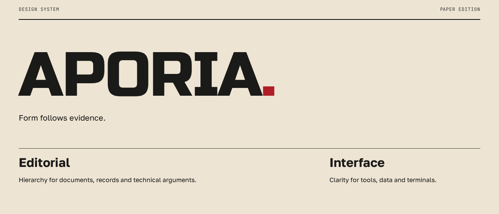

# Aporia

Aporia is an archival design system for technical publications, software interfaces and terminals. Its identity comes from structure, useful density, restrained color and evidence the reader can inspect.



**Lacuna Paper and Lacuna Ink** are Aporia's generated editor and terminal themes.

## Design with Aporia

| Need | Start here |
| --- | --- |
| Brief a coding agent | [AGENTS.md](AGENTS.md), [portable workflow](packages/agent-skill/) |
| Apply the design system | [Design contract](DESIGN.md), [philosophy](docs/PHILOSOPHY.md), [rulebook](aporia/RULES.md) |
| Find a working example | [Reference library](references/) |
| Understand a decision | [Design decision records](docs/decisions/), [changelog](CHANGELOG.md) |
| Browse the system locally | Open [site/index.html](site/index.html), or build the documentation site below |

The canonical [tokens](aporia/tokens.json) own values and the [rulebook](aporia/RULES.md) owns rule scope. Generated themes, examples and captures illustrate their use. See [architecture](docs/ARCHITECTURE.md) for the build and adapter contract.

## Lacuna

[Open the Paper and Ink browser comparison](previews/dist/index.html) for syntax colors from canonical semantic roles and the 24 editor specimens. The specimens simulate the host interfaces.

| Host | Paper | Ink |
| --- | --- | --- |
| Helix | [Native capture](docs/screenshots/native/helix-paper.png) | [Native capture](docs/screenshots/native/helix-ink.png) |
| Zed | [Native capture](docs/screenshots/native/zed-paper.png) | [Native capture](docs/screenshots/native/zed-ink.png) |
| Kitty | [Native capture](docs/screenshots/native/kitty-paper.png) | [Native capture](docs/screenshots/native/kitty-ink.png) |

See [capture provenance](docs/screenshots/) for host versions, fixture files and states. Use the [installation guide](docs/INSTALL.md) for Helix, Zed, VS Code, Kitty, Ghostty, Alacritty and WezTerm. Web consumers can use [the generated CSS and JSON](dist/web/).

## Build and verify

The token and theme build requires Node 20+ and no installed npm packages.

```sh
npm run verify
```

To build the static documentation site, run the browser checks and build the portable workflow:

```sh
npm ci
npm run build:site
npx playwright install chromium
npm run test:visual
npm run package:skill
```

The complete site is in `site-output/`. Open its `index.html` locally or serve that directory under any static host. For GitHub Pages, set Pages source to GitHub Actions and run the **Publish Aporia design system** workflow.

See [the QA guide](docs/QA.md) and [contribution guide](CONTRIBUTING.md). Distributed under the [Apache License 2.0](LICENSE), with attribution in [NOTICE](NOTICE) and separate licenses for the bundled fonts.
