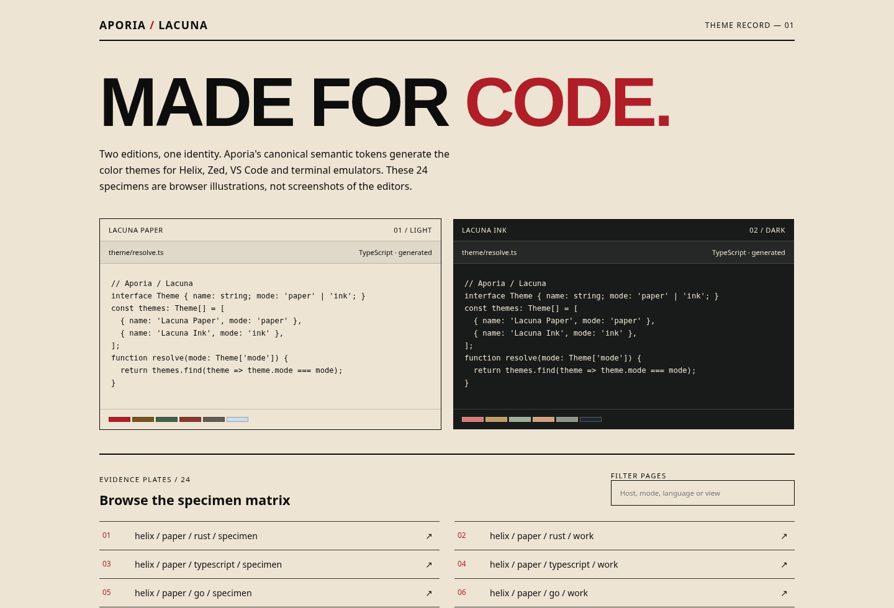

# APORIA / LACUNA

**Aporia** is the identity and design-token system. **Lacuna** is its generated color theme family: **Lacuna Paper** (light) and **Lacuna Ink** (dark). This repository contains the token source, reproducible build scripts, distributable host themes, and a self-contained 24-page browser specimen gallery.

All runtime color decisions originate in **[`aporia/tokens.json`](aporia/tokens.json)**. No host theme or browser page maintains its own production color palette.



*Browser-rendered gallery mockup, not a screenshot from Helix, Zed or another editor.*

## Start here

```sh
# Node.js 20+; no npm dependencies, package installation, or network needed
npm run build        # all theme outputs + 24 specimens + gallery index
npm test             # format, token parity, contrast and link validation
npm run check:drift  # regenerate and demand byte-identical artifacts
npm run verify       # build + tests + drift detection
```

Open **[`previews/dist/index.html`](previews/dist/index.html)** in a browser to compare Paper and Ink and browse 24 Helix/Zed specimens. These pages contain inline CSS, data and markup; they do not make network requests or require a local web server.

## Installable theme targets

| Target | Generated artifacts | Install instructions |
|---|---|---|
| Helix | [`dist/helix/`](dist/helix/) | Copy `lacuna-{paper,ink}.toml` to your themes directory |
| Zed | [`dist/zed/`](dist/zed/) | Local `lacuna.json`, or extension folder `themes/` + `extension.toml` |
| VS Code | [`dist/vscode/`](dist/vscode/) | Self-contained local color-theme extension with two themes |
| Kitty | [`dist/kitty/`](dist/kitty/) | Include `lacuna-{paper,ink}.conf` |
| Ghostty | [`dist/ghostty/`](dist/ghostty/) | Configure a named theme, or system light/dark pair |
| Alacritty | [`dist/alacritty/`](dist/alacritty/) | Import `lacuna-{paper,ink}.toml` |
| WezTerm | [`dist/wezterm/`](dist/wezterm/) | Load the generated Lua colors table |
| Web / other clients | [`dist/web/`](dist/web/) | CSS variables + resolved JSON and JavaScript |

**Detailed, copy-ready commands:** [docs/INSTALL.md](docs/INSTALL.md)

## Repository map

```text
aporia/
├── aporia/
│   ├── tokens.json                 # ONLY canonical source of token values
│   ├── RULES.md                    # Core, Editorial, Interface and Lacuna rules
│   └── build.mjs                   # shared token resolver + 327-pair WCAG gate
├── scripts/
│   ├── build.mjs                   # orchestrates all generators
│   ├── build-platforms.mjs         # VS Code, Kitty, Ghostty, Alacritty, WezTerm
│   ├── build-gallery.mjs           # gallery from exact resolved host tokens
│   ├── check.mjs                   # offline structural and content checks
│   └── check-drift.mjs             # byte-identical rebuild detection
├── dist/                           # ALL generated: do not edit
│   ├── helix/  zed/  vscode/
│   ├── kitty/  ghostty/  alacritty/  wezterm/
│   ├── web/                        # CSS, JS, resolved JSON
│   └── reports/                    # token ownership and contrast details
├── previews/
│   ├── src/                        # browser specimen layout & examples only
│   └── dist/                       # 24 standalone HTML pages + index
├── docs/                           # architecture, installation, QA, identity
├── .github/workflows/validate.yml
└── package.json
```

## Design authority

1. **[`aporia/tokens.json`](aporia/tokens.json)** owns numeric and color values; **[`aporia/RULES.md`](aporia/RULES.md)** owns the scope of identity rules.
2. `aporia/build.mjs` resolves all tokens and writes canonical web, Helix and Zed outputs. The platform and gallery generators consume those **resolved values**; they cannot re-pick a color.
3. [`docs/ARCHITECTURE.md`](docs/ARCHITECTURE.md) describes adapters; [`docs/BRAND.md`](docs/BRAND.md) offers non-conflicting creative guidance.
4. `previews/dist` is **illustrative**: staged browser approximations, not true captures of the host editors. Theme artifacts are the installable source of truth for each host.
5. Aporia Editorial's printed-page constraints **do not** prohibit ordinary application UI, icons, density or dark modes in Aporia Interface and Lacuna.

## Current validation status

- 48 primitive color tokens; 79 semantic color roles for each of two modes.
- 327 canonical WCAG contrast pair checks, passing at generation time.
- Dependency-free structural verification, local HTML link checks, JSON parsing, optional Python 3.11+ TOML parsing, and deterministic build checks.
- Real Helix, Zed, VS Code and terminal **host runtime screenshots have not been verified** in this package. See [docs/QA.md](docs/QA.md) for repeatable manual acceptance steps.

## Changing a token

Edit `aporia/tokens.json`, run `npm run build`, inspect the host outputs and preview gallery, then run `npm run verify`. Do not hand-edit anything in `dist/` or `previews/dist/`.

**License:** no open-source license has been selected on the author's behalf. See [LICENSE-NOTICE.md](LICENSE-NOTICE.md) before publishing or accepting external contributions.
